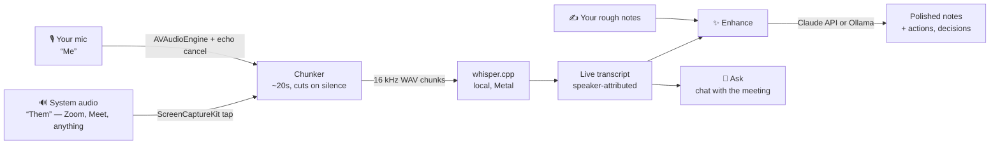

# 🥣 Muesli

> [!TIP]
> **Configuração recomendada (gratuita e rápida):** No macOS, você pode manter o **Whisper local** ou usar o **Groq** via chave(s) de API (**é gratuito — basta criar uma conta em [console.groq.com](https://console.groq.com)**) tanto como motor de transcrição (**Whisper `whisper-large-v3-turbo`** — também com suporte a **OpenAI** e **OpenRouter**) quanto como provedor de **Modelos de IA**, recomendando o modelo **`qwen/qwen3.8-27b`**. Também há suporte nativo a **Google Gemini**, **OpenAI** (ou compatíveis), **Anthropic Claude** e **Ollama local**, com rotação automática entre múltiplas chaves.

**The open-source meeting notepad.** Granola-style AI meeting notes — your mic, your Mac, your models, your files.

Muesli records both sides of a call **without a bot joining the meeting**, lets you type rough notes while you talk, and organizes meetings into user-created categories. Transcription can run locally with Whisper or through Groq, OpenAI, or OpenRouter; optional AI providers can then turn notes and transcript into polished minutes.

> Granola is a lovely product. It is also closed-source, subscription-priced, and your meetings live on someone else's servers. Muesli is the muesli to their granola: the same breakfast, but you can see every ingredient.

## How it works



- **No bot in the call.** System audio is captured from macOS itself via ScreenCaptureKit, so Muesli works with Zoom, Meet, Teams, Slack huddles, phone calls through the Mac — anything that makes sound.
- **Speaker attribution for free.** Your mic is `Me`, system audio is `Them`. Two streams, transcribed separately, interleaved by time.
- **Privacy is explicit.** Local Whisper keeps audio on the Mac. Cloud transcription sends audio chunks to the selected speech provider; the app displays the active capture, transcription, fallback, and automatic-enhancement behavior while recording. ✨ Enhance / Ask can send meeting text to a cloud AI provider, or stay local via Ollama.
- **Organized by category.** Create as many categories as you need, move meetings between them, and use the **+** beside a category to create and start a new recording directly inside it.
- **Plain files.** Every meeting is a folder of `meeting.json`, `notes.md`, `transcript.md`, `enhanced.md`, `mic.wav`, `system.wav`. No lock-in; `grep` works.

## Quick start

```bash
brew install whisper-cpp # only when using local Whisper
git clone <your-fork-or-path>/muesli && cd muesli
make run
```

First launch shows a setup checklist:

1. **Microphone** — one click.
2. **System audio** — macOS gates this behind *Privacy & Security → Screen & System Audio Recording*. Enable Muesli there, then relaunch. (Audio-only capture still requires the screen-recording permission; that's a macOS design decision, not ours.)
3. **Whisper engine** — found automatically if installed via Homebrew; optional when using cloud STT without local fallback.
4. **Speech model** — one-click download (base.en, 142 MB, recommended for local transcription or fallback).
5. **AI provider** *(optional)* — configure Groq, Gemini, OpenAI/compatible APIs, Anthropic, or Ollama. Cloud providers receive meeting text when you use ✨ Enhance or Ask; Ollama can keep those requests local.

During recording, Muesli displays whether capture includes microphone and system audio, whether transcription is local or sends audio to a cloud provider, whether local fallback is enabled, and whether automatic enhancement will send text to an AI provider. Muesli captures audio only; it does not save screen video.

Then hit **Start meeting**, talk, type fragments, hit **Stop**, hit **✨ Enhance**.

## Using it well

- **Type badly on purpose.** Rough notes are a steering wheel, not a record — `pricing?? sarah owns redesign` is enough. The transcript supplies the facts; your notes supply the emphasis.
- **Templates** (Auto, 1:1, Sales, Standup, Interview, Brainstorm) change the structure of enhanced notes. Pick one in the meeting header.
- **Headphones help.** Echo cancellation is on by default and keeps speaker audio out of your mic stream, but headphones make `Me`/`Them` separation bulletproof.
- **Re-transcribe from audio** (⋯ menu) re-runs Whisper over the full-session WAVs — useful after upgrading models, or if the app quit mid-meeting.
- **Ask** answers questions grounded in one meeting's transcript + notes ("what did we decide?", "draft the follow-up email").

## AI providers

| Provider | Setup | Notes |
|---|---|---|
| **Automatic** | Configure one or more providers | Tries configured providers in this order: Groq, Gemini, Anthropic, OpenAI, then Ollama. |
| **Groq** | API key in Settings → Modelos de IA | OpenAI-compatible chat API; multiple keys rotate automatically. |
| **Google Gemini** | API key in Settings → Modelos de IA | Gemini `generateContent` API; multiple keys rotate automatically. |
| **OpenAI / compatible** | API key and base URL in Settings → Modelos de IA | Supports OpenAI-compatible endpoints, including local or proxy endpoints. |
| **Anthropic Claude** | API key in Settings → Modelos de IA | Uses the Anthropic Messages API; multiple keys rotate automatically. |
| **Ollama** | Run Ollama and select a model | Local chat endpoint. Long transcripts are shortened to fit the prompt budget. |

For speech transcription, the available engines are local Whisper, Groq, OpenAI, and OpenRouter. Cloud STT uploads audio chunks to the selected provider; local Whisper can be enabled as a fallback.

## Whisper models

| Model | Size | When |
|---|---|---|
| tiny.en | 75 MB | Old machines |
| **base.en** | 142 MB | **Recommended** — ~10–20× realtime on Apple Silicon |
| small.en | 466 MB | Noisy audio, accents |
| large-v3-turbo | 1.5 GB | Best quality + non-English (set language to `auto`) |

Download and switch in Settings → Transcription.

## Architecture

```
Sources/Muesli/
├── Audio/            capture + chunking
│   ├── MicRecorder          AVAudioEngine tap, optional voice processing (AEC)
│   ├── SystemAudioRecorder  ScreenCaptureKit audio tap (video frames discarded)
│   ├── StreamConverter      anything → 16 kHz mono Int16
│   ├── RecordingSession     full-session WAVs + silence-aware ~20 s chunks
│   └── WavWriter            streaming WAV with header patch-up
├── Transcription/
│   ├── WhisperTranscriber   whisper-cli wrapper (JSON out, prompt-chaining, artifact filter)
│   ├── TranscriptionPipeline serial actor: chunk queue → segments → store
│   ├── CloudTranscriber     Groq/OpenAI/OpenRouter speech API and chunk batching
│   └── WhisperModels        model catalog + downloader
├── Enhance/
│   ├── Enhancer             Groq/Gemini/OpenAI/Anthropic/Ollama clients, prompts
│   └── Templates            note structures (Auto, 1:1, Sales, …)
├── Storage/MeetingStore     JSON source of truth + .md mirrors, Trash-based delete
├── UI/                      SwiftUI: sidebar, tabs, live record bar, setup, settings
└── Support/                 settings, keychain, permissions, hidden CLI
```

Category definitions are stored in `categories.json`; each meeting stores its category ID in `meeting.json`. Older meeting files without a category remain valid and appear under **Sem categoria**.

Zero package dependencies — Apple frameworks plus the `whisper-cli` binary.

### Hidden CLI (used by CI / verification)

```bash
Muesli --selftest            # storage, wav, parser, coalescing checks
Muesli --transcribe f.wav    # run a file through the app's whisper path
Muesli --enhance-test        # ping the configured AI provider
```

## Troubleshooting

- **"SwiftPM unavailable" during build** — some Command Line Tools installs ship a mismatched SwiftPM/SDK. `Scripts/build-app.sh` detects this and compiles with `swiftc` directly; no action needed.
- **System audio permission enabled but capture fails** — relaunch Muesli after granting. If you rebuilt the app, macOS may want the toggle flipped off/on again (ad-hoc signatures change per build).
- **Transcript shows things nobody said during silence** — Whisper hallucinates on silence; Muesli gates silent chunks and filters the classic phantoms ("Thank you.", `[BLANK_AUDIO]`), but a noisy room can still sneak one through.
- **`Me` text appearing as `Them` too** — you're on speakers with echo cancellation off. Turn it on (Settings → Recording) or wear headphones.
- **Mic not recording / echo-cancel warnings** — Apple's voice-processing unit (AUVoiceIO) is broken on some Macs: enabling it can stall for minutes, fail with `-10875`, or deliver pure silence — and toggling it reconfigures the input device out from under any live engine. Muesli therefore brings the voice-processed engine up on a throwaway thread under a 5 s deadline *before* anything else records, falls back to the raw mic on any failure, remembers the verdict (so later recordings start instantly), watchdogs the first 2.5 s of audio for silence, and auto-restarts capture when the input device changes mid-meeting. Diagnose your machine any time with:
  `./build/Muesli.app/Contents/MacOS/Muesli --mictest` (prints buffer counts and peak levels with echo cancellation on and off).

## Roadmap

- Calendar awareness (EventKit): auto-title and auto-start from the meeting you're in
- Import from Granola
- Cross-meeting search and chat
- Streaming enhancement (watch notes write themselves)
- Real signing + notarized releases
- Windows/Linux… someone else's PR 🙂

## License

MIT — see [LICENSE](LICENSE). Not affiliated with, endorsed by, or connected to Granola Inc.; "Granola" is referenced only to describe a category of product. 🥣
