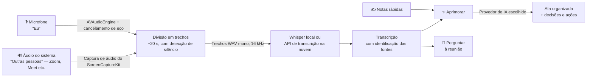
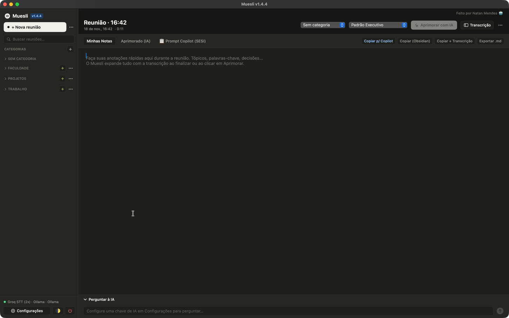
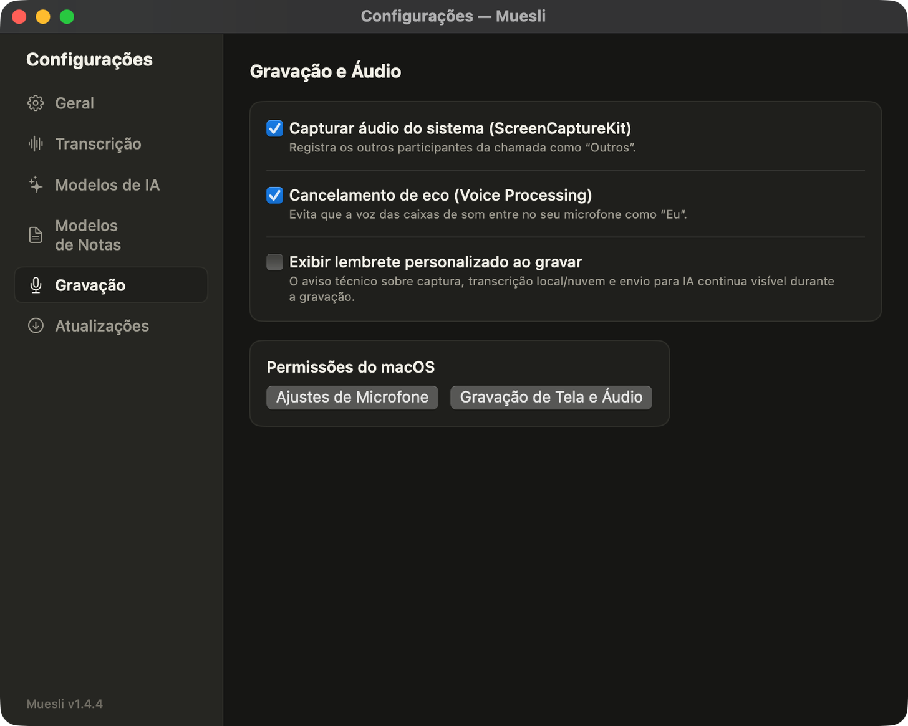

# 🥣 Muesli para macOS

> [!TIP]
> **Configuração sugerida:** use o Whisper local para manter a transcrição no Mac ou configure uma chave de API para transcrever com Groq, OpenAI ou OpenRouter. Para aprimorar notas e conversar com uma reunião, o Muesli também integra Google Gemini, OpenAI e compatíveis, Anthropic Claude e Ollama local. É possível configurar mais de uma chave nos provedores compatíveis; o app alterna entre elas quando necessário.

**Um bloco de notas de reuniões de código aberto.** Grave com o microfone e o áudio do sistema, escreva notas rápidas durante a conversa e mantenha os arquivos sob seu controle.

O Muesli não precisa de um bot para entrar na chamada. A transcrição pode ser processada localmente com Whisper ou enviada, em trechos de áudio, a um provedor de STT na nuvem. Depois, você pode aprimorar as notas com um provedor de IA local ou remoto.

> O Granola é uma referência conhecida nessa categoria. O Muesli oferece uma alternativa de código aberto, com arquivos locais e opções para escolher onde o áudio e o texto são processados. O Muesli é o cereal do seu jeito: você pode ver e controlar os ingredientes.

## Como funciona



- **Sem bot na chamada.** O áudio do sistema é capturado pelo macOS via ScreenCaptureKit. Assim, o Muesli pode funcionar com Zoom, Meet, Teams, Slack e outras chamadas que reproduzam áudio no Mac.
- **Separação das fontes de áudio.** O microfone e o áudio do sistema são capturados em fluxos separados e identificados na transcrição.
- **Privacidade visível durante a gravação.** O aviso informa se a captura está configurada para microfone e áudio do sistema ou somente microfone, se a transcrição é local ou usa um serviço na nuvem, se há fallback local e se a ata automática enviará texto para uma IA. O Muesli captura áudio, **não grava nem salva vídeo da tela**.
- **Categorias de reuniões.** Crie quantas categorias quiser, mova reuniões entre elas, recolha ou expanda cada categoria e use o botão **+** para criar e começar uma gravação diretamente nela.
- **Arquivos acessíveis.** Cada reunião é armazenada em uma pasta com `meeting.json`, `notes.md`, `transcript.md`, `enhanced.md` e, quando gravados, `mic.wav` e `system.wav`. Seus dados não ficam presos a um formato proprietário.

## Funcionalidades disponíveis na versão 1.4.4

- **Organização flexível:** categorias podem ser criadas, renomeadas e excluídas. Excluir uma categoria não apaga as reuniões; elas passam para **Sem categoria**.
- **Barra lateral mais compacta:** cada categoria pode ser recolhida ou expandida individualmente. O estado fica salvo entre execuções do app; durante uma busca, as categorias com resultados se expandem para mostrar as reuniões encontradas.
- **Gravação rápida por categoria:** o botão **+** ao lado de uma categoria cria uma reunião associada a ela e inicia a gravação usando as opções de captura configuradas.
- **Categoria por reunião:** escolha ou altere a categoria nos detalhes da reunião ou pelo menu de contexto na barra lateral.
- **Aviso técnico de privacidade:** durante a gravação, o Muesli informa o destino do áudio e do texto conforme as configurações ativas. Desativar o lembrete personalizado não oculta esse aviso.
- **Transcrição local ou na nuvem:** escolha Whisper local ou os serviços de STT compatíveis. Com a transcrição na nuvem, trechos de áudio são enviados ao provedor selecionado; o Whisper local pode servir como fallback, se estiver instalado e configurado.

## Capturas de tela

Capturas reais da interface do Muesli v1.4.4.

### Tela principal

A barra lateral mostra as categorias recolhidas para facilitar uma visão geral; cada uma pode ser expandida para exibir suas reuniões.



### Configurações de gravação e áudio

As opções de captura e o lembrete personalizado ficam nas configurações de gravação. O aviso técnico de privacidade continua visível durante a gravação.



## Início rápido

```bash
brew install whisper-cpp # somente para usar o Whisper local ou fallback local
git clone https://github.com/NatanMendes0/muesli-macos.git
cd muesli-macos
make run
```

Na primeira abertura, o Muesli apresenta uma lista de configuração:

1. **Microfone** — conceda a permissão solicitada pelo macOS.
2. **Áudio do sistema** — habilite o Muesli em *Ajustes do Sistema → Privacidade e Segurança → Gravação de Áudio e Sistema*. O macOS exige essa permissão mesmo para capturar somente áudio. Reinicie o Muesli depois de concedê-la.
3. **Whisper** — o executável é detectado automaticamente se estiver instalado pelo Homebrew. Ele é opcional quando você usa STT na nuvem sem fallback local.
4. **Modelo de fala** — o modelo pode ser baixado pelo app. `base.en` (142 MB) é uma opção recomendada para transcrição local ou fallback.
5. **Provedor de IA** *(opcional)* — configure Groq, Gemini, OpenAI ou compatível, Anthropic ou Ollama. Provedores remotos recebem texto da reunião quando você usa **Aprimorar** ou **Perguntar**; o Ollama pode processar essas solicitações localmente.

Durante a gravação, o aviso técnico mostra o comportamento configurado para captura, transcrição, fallback e aprimoramento automático. Não é criado arquivo de vídeo.

Fluxo básico: clique em **+ Nova reunião**, converse e anote os pontos importantes, clique em **Parar gravação** e use **✨ Aprimorar** para gerar uma ata — ou deixe o aprimoramento automático ativado nas configurações.

## Dicas de uso

- **Faça notas rápidas, sem se preocupar com a forma.** Anotações como `rever preço — Ana cuida do redesign` já ajudam: a transcrição fornece o contexto e suas notas destacam o que importa.
- **Use modelos de ata.** Modelos como Auto, 1:1, Vendas, Stand-up, Entrevista e Brainstorm mudam a estrutura do texto aprimorado. Selecione um deles no cabeçalho da reunião.
- **Prefira fones de ouvido.** O cancelamento de eco ajuda a evitar que o áudio dos outros participantes volte pelo microfone. Fones melhoram ainda mais a separação das fontes.
- **Transcreva novamente a partir do áudio.** No menu **⋯**, você pode reprocessar os arquivos de áudio com Whisper local — por exemplo, depois de trocar o modelo ou se a transcrição não tiver sido concluída.
- **Pergunte sobre uma reunião.** O recurso **Perguntar** responde com base na transcrição e nas notas daquela reunião, por exemplo: “o que decidimos?” ou “redija um e-mail de acompanhamento”.
- **Organize a barra lateral.** Recolha categorias que não estiver usando para ter uma visão geral mais compacta; expanda-as novamente quando quiser acessar as conversas.

## Provedores de IA para aprimorar notas e responder perguntas

| Provedor | Configuração | Observações |
|---|---|---|
| **Automático** | Configure um ou mais provedores | Tenta os provedores configurados nesta ordem: Groq, Gemini, Anthropic, OpenAI e Ollama. |
| **Groq** | Chave de API em Configurações → Modelos de IA | API de chat compatível com OpenAI; permite rotação entre várias chaves. |
| **Google Gemini** | Chave de API em Configurações → Modelos de IA | API `generateContent` do Gemini; permite rotação entre várias chaves. |
| **OpenAI e compatíveis** | Chave de API e URL-base em Configurações → Modelos de IA | Aceita endpoints compatíveis com OpenAI, inclusive endpoints locais ou proxies. |
| **Anthropic Claude** | Chave de API em Configurações → Modelos de IA | Usa a API Messages da Anthropic; permite rotação entre várias chaves. |
| **Ollama** | Execute o Ollama e selecione um modelo | Endpoint local de chat. Transcrições longas são reduzidas para caber no limite do prompt. |

Para **transcrição de fala (STT)**, os mecanismos disponíveis são Whisper local, Groq, OpenAI e OpenRouter. O STT na nuvem envia trechos de áudio ao provedor selecionado. O Whisper local pode ser usado como fallback quando configurado.

## Modelos Whisper

| Modelo | Tamanho aproximado | Indicação |
|---|---:|---|
| `tiny.en` | 75 MB | Máquinas mais antigas |
| **`base.en`** | 142 MB | Opção recomendada para começar |
| `small.en` | 466 MB | Áudio ruidoso ou sotaques variados |
| `large-v3-turbo` | 1,5 GB | Maior qualidade e outros idiomas; configure o idioma como `auto` |

Baixe e selecione modelos em **Configurações → Transcrição**.

## Arquitetura

```text
Sources/Muesli/
├── Audio/                      captura e divisão do áudio
│   ├── MicRecorder             captura via AVAudioEngine e processamento de voz opcional (AEC)
│   ├── SystemAudioRecorder     captura de áudio via ScreenCaptureKit; quadros de vídeo são descartados
│   ├── StreamConverter         conversão para áudio mono Int16 a 16 kHz
│   ├── RecordingSession        WAVs da sessão e trechos de ~20 s com detecção de silêncio
│   └── WavWriter               gravação progressiva de WAV
├── Transcription/
│   ├── WhisperTranscriber      integração com whisper-cli, JSON e filtros de artefatos
│   ├── TranscriptionPipeline   fila serial de trechos, segmentos e persistência
│   ├── CloudTranscriber        APIs de fala Groq/OpenAI/OpenRouter e divisão em lotes
│   └── WhisperModels           catálogo e download de modelos
├── Enhance/
│   ├── Enhancer                clientes Groq/Gemini/OpenAI/Anthropic/Ollama e prompts
│   └── Templates               estruturas de notas (Auto, 1:1, Vendas etc.)
├── Storage/MeetingStore        JSON como fonte de dados e espelhos Markdown; exclusão via Lixo
├── UI/                         interface SwiftUI: barra lateral, abas, gravação, configuração
└── Support/                    preferências, Keychain, permissões e CLI interno
```

As categorias são armazenadas em `categories.json`; cada reunião guarda o identificador da categoria em `meeting.json`. Reuniões antigas sem esse campo continuam válidas e aparecem em **Sem categoria**.

O projeto não tem dependências Swift externas: usa frameworks da Apple e, opcionalmente, o executável `whisper-cli` para transcrição local.

### CLI interno (CI e verificação)

```bash
Muesli --selftest             # verifica armazenamento, WAV e parser
Muesli --transcribe arquivo.wav # transcreve um arquivo pelo caminho Whisper do app
Muesli --enhance-test         # testa o provedor de IA configurado
```

## Solução de problemas

- **“SwiftPM indisponível” durante a compilação** — algumas instalações das Command Line Tools incluem versões incompatíveis de SwiftPM e do SDK. `Scripts/build-app.sh` tenta compilar com `swiftc` diretamente como alternativa.
- **A permissão de áudio do sistema está ativa, mas a captura falha** — reinicie o Muesli depois de conceder a permissão. Após recompilar o app, talvez seja necessário desativar e reativar a permissão, pois a assinatura local pode mudar.
- **A transcrição inclui palavras que ninguém disse durante o silêncio** — o Whisper pode alucinar em trechos silenciosos. O Muesli detecta silêncio e filtra artefatos conhecidos, como “Thank you.” e `[BLANK_AUDIO]`, mas ambientes ruidosos ainda podem gerar falsos positivos.
- **O texto do microfone aparece também como áudio do sistema** — isso pode ocorrer usando alto-falantes com o cancelamento de eco desativado. Ative-o em **Configurações → Gravação** ou use fones de ouvido.
- **O microfone não grava ou há avisos de cancelamento de eco** — a unidade de processamento de voz da Apple (AUVoiceIO) pode falhar em alguns Macs, demorar para iniciar ou produzir silêncio. O Muesli testa o mecanismo com limite de tempo, recorre ao microfone sem processamento quando necessário, verifica o áudio inicial e pode reiniciar a captura se o dispositivo de entrada mudar durante a reunião. Para diagnosticar, execute:
  `./build/Muesli.app/Contents/MacOS/Muesli --mictest` (mostra contagens de buffers e níveis de pico com o cancelamento de eco ligado e desligado).

## Próximos passos

- Integração com Calendário (EventKit): identificar reuniões e iniciar ou nomear gravações automaticamente
- Importação de reuniões do Granola
- Busca e conversa entre várias reuniões
- Aprimoramento em streaming, com a ata sendo atualizada enquanto é gerada
- Assinatura e notarização oficiais para as versões distribuídas
- Suporte a Windows/Linux… talvez em uma contribuição da comunidade 🙂

## Licença

MIT — consulte [LICENSE](LICENSE). O Muesli não é afiliado, endossado nem associado à Granola Inc.; “Granola” é citado apenas para descrever uma categoria de produto. 🥣
